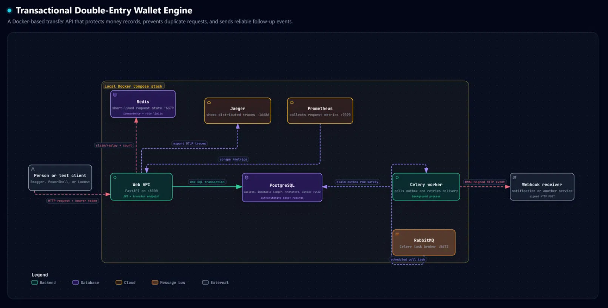

# Transactional Double-Entry Wallet Engine

A Docker-based transfer API that protects money records, prevents duplicate requests, and delivers reliable follow-up events. Built with FastAPI, PostgreSQL, SQLAlchemy, Redis, Celery, and RabbitMQ.

## Architecture



1. A client sends an HTTP request with a bearer token to the **Web API** (FastAPI).
2. **Redis** handles the idempotency claim/replay and per-user rate limiting.
3. The API runs the transfer in **one PostgreSQL transaction**: it locks both wallets, writes the ledger entries, and records the transfer.
4. A database trigger creates a pending **outbox event** in that same transaction.
5. A **Celery worker** (broker: RabbitMQ) polls the outbox, claims rows safely, and sends an HMAC-signed HTTP event to a webhook receiver.
6. **Jaeger** receives OpenTelemetry traces, and **Prometheus** scrapes `/metrics`.

## Design

- `ledger_entries` is append-only. A transfer creates exactly one debit and one credit row with the same `transaction_id`.
- Wallet balances are calculated as `SUM(credits) - SUM(debits)`; there is no mutable balance column.
- Transfers run in one PostgreSQL transaction and lock both wallets with `SELECT ... FOR UPDATE` in ascending UUID order, which prevents deadlocks and negative balances.
- `Idempotency-Key` is required for `POST /transfers`. Redis uses `SET NX EX` for the claim and stores the completed HTTP response, so a retried request gets the original response instead of a second transfer.
- Inserting a committed `wallet_transfers` row fires a PostgreSQL trigger that creates one pending outbox event in the same transaction (transactional outbox pattern), so an event is never lost or sent for a transfer that rolled back.
- Celery polls the outbox with `FOR UPDATE SKIP LOCKED`, dispatches the event, and marks it dispatched or failed.

## Features

- Double-entry accounting with an append-only ledger
- JWT authentication and wallet ownership checks
- Redis-backed idempotency keys and rate limiting
- Transactional-outbox webhooks with HMAC signatures and retries
- Prometheus metrics and OpenTelemetry tracing (Jaeger)
- Concurrency load test with Locust, run in CI

## Tech Stack

| Component | Role | Port |
| --- | --- | --- |
| FastAPI | Web API, JWT auth, transfer endpoint | 8000 |
| PostgreSQL | Wallets, immutable ledger, transfers, outbox | 5432 |
| Redis | Idempotency and rate limits | 6379 |
| RabbitMQ | Celery task broker | 5672 |
| Celery | Polls the outbox and delivers webhooks | - |
| Prometheus | Request metrics | 9090 |
| Jaeger | Distributed traces | 16686 |

## Concurrency Test Results

The Locust scenario fires 500 concurrent transfers at one source wallet. After the run:

- **0** negative balances
- **0** balance discrepancies
- the **500-unit total** across wallets is preserved

CI runs the same 500-user test on every push and uploads the recorded results as a workflow artifact.

## Run Locally with Docker

```bash
cp .env.example .env
docker compose up --build
```

| Service | URL |
| --- | --- |
| API | http://localhost:8000 |
| OpenAPI docs (Swagger) | http://localhost:8000/docs |
| Prometheus | http://localhost:9090 |
| Jaeger | http://localhost:16686 |

The local bootstrap user is `wallet-demo` / `wallet-demo-password`. Change these values before sharing the environment.

## Quick Start: Make a Transfer

Authenticate through Swagger's **Authorize** button, or follow the steps below.

<details open>
<summary>macOS / Linux (curl)</summary>

```bash
# 1. Get a token
TOKEN=$(curl -s -X POST http://localhost:8000/auth/token \
  -d 'username=wallet-demo&password=wallet-demo-password' | python3 -c "import sys, json; print(json.load(sys.stdin)['access_token'])")

# 2. Create two wallets
A=$(curl -s -X POST http://localhost:8000/wallets -H "Authorization: Bearer $TOKEN" \
  -H 'Content-Type: application/json' -d '{"currency":"USD"}' | python3 -c "import sys, json; print(json.load(sys.stdin)['id'])")
B=$(curl -s -X POST http://localhost:8000/wallets -H "Authorization: Bearer $TOKEN" \
  -H 'Content-Type: application/json' -d '{"currency":"USD"}' | python3 -c "import sys, json; print(json.load(sys.stdin)['id'])")

# 3. Seed the source wallet with 100
curl -X POST "http://localhost:8000/admin/wallets/$A/credit?amount=100" -H "Authorization: Bearer $TOKEN"

# 4. Transfer 10 (the Idempotency-Key header is required)
curl -X POST http://localhost:8000/transfers \
  -H "Authorization: Bearer $TOKEN" -H "Idempotency-Key: demo-1" \
  -H 'Content-Type: application/json' \
  -d "{\"source_wallet_id\":\"$A\",\"destination_wallet_id\":\"$B\",\"amount\":\"10.00\",\"currency\":\"USD\"}"
```

</details>

<details>
<summary>Windows (PowerShell)</summary>

```powershell
$token = (Invoke-RestMethod -Method Post http://localhost:8000/auth/token `
  -ContentType 'application/x-www-form-urlencoded' `
  -Body 'username=wallet-demo&password=wallet-demo-password').access_token
$auth = @{ Authorization = "Bearer $token" }
$a = Invoke-RestMethod -Method Post http://localhost:8000/wallets -Headers $auth -ContentType 'application/json' -Body '{"currency":"USD"}'
$b = Invoke-RestMethod -Method Post http://localhost:8000/wallets -Headers $auth -ContentType 'application/json' -Body '{"currency":"USD"}'
Invoke-RestMethod -Method Post "http://localhost:8000/admin/wallets/$($a.id)/credit?amount=100" -Headers $auth
$transferHeaders = @{ Authorization = "Bearer $token"; "Idempotency-Key" = "demo-1" }
Invoke-RestMethod -Method Post http://localhost:8000/transfers -Headers $transferHeaders -ContentType 'application/json' -Body (ConvertTo-Json @{source_wallet_id=$a.id; destination_wallet_id=$b.id; amount="10.00"; currency="USD"})
```

</details>

Send the same transfer again with the same `Idempotency-Key` and you get the original response back; no second transfer is made.

## Tests and Load Testing

Metrics are exposed at `http://localhost:8000/metrics`. Set `OTEL_EXPORTER_OTLP_ENDPOINT` to export OpenTelemetry traces to Jaeger, Grafana Tempo, or another OTLP collector.

Install the dependencies and run the unit and integration tests against a PostgreSQL and Redis instance:

```bash
pip install -r requirements.txt
pytest -q
```

The included Locust scenario creates two wallets, funds the source through the admin seed endpoint, and fires transfers at one source wallet:

```bash
locust -f loadtest/locustfile.py --host http://localhost:8000 -u 500 -r 500 --run-time 30s --headless
```

On Windows, save timestamped CSV and JSON results with:

```powershell
.\loadtest\run.ps1
```

The test reports failed requests and checks the source balance after the run. It intentionally uses a unique idempotency key per request; retry behavior is covered by `tests/test_idempotency.py`.

## Configuration

Copy `.env.example` to `.env`. Key settings:

| Variable | Purpose | Default |
| --- | --- | --- |
| `DATABASE_URL` | Async PostgreSQL connection for the API | local `wallet` database |
| `REDIS_URL` | Idempotency and rate limiting | `redis://localhost:6379/0` |
| `CELERY_BROKER_URL` | RabbitMQ broker | local `amqp://` URL |
| `IDEMPOTENCY_TTL_SECONDS` | How long idempotency keys are kept | `86400` |
| `RATE_LIMIT_PER_MINUTE` | Per-user request limit | `120` |
| `OUTBOX_POLL_SECONDS` | How often the worker polls the outbox | `5` |
| `ACCESS_TOKEN_EXPIRE_MINUTES` | JWT lifetime | `60` |
| `JWT_SECRET` | JWT signing secret | placeholder, replace it |
| `WEBHOOK_URL` | Where signed events are delivered | local dev receiver |
| `WEBHOOK_SIGNING_SECRET` | HMAC key for webhook signatures | placeholder, replace it |
| `OTEL_EXPORTER_OTLP_ENDPOINT` | Trace export target | empty (disabled) |

The Docker defaults are for local development only.

## Production Notes

This is a reference implementation. For a production deployment, replace the local defaults with managed services, TLS/HTTPS, secret management, backups, alerting, a real identity model, and a hardened external webhook or notification provider.

## License

MIT. See [`LICENSE`](LICENSE).
